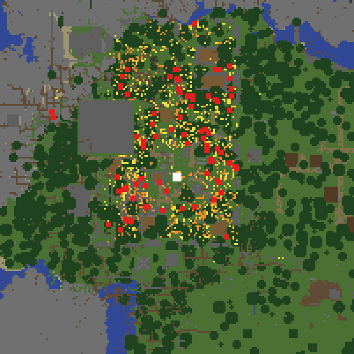

# planahead-01: plan the town ahead (2026-11-09)

OWNER 11-09 ~14:30Z: "lets do 1,2,3 and do the crew size check". This is #2 of that list = idea #4 (+ #5) of
[`minecraft-ai-landscape-2026-11-09.md`](minecraft-ai-landscape-2026-11-09.md) section 3: plan the town in memory with land claims
before placing a block (GDMC 2022 winner, arXiv 2309.10871: shared claim maps, roads first, plots that touch roads), and
Baritone-style tolerance (`buildSkipBlocks`, `okIfAir`) so a cell that becomes unreachable later closes instead of stalling.
Ledger row `planahead-1109`. Folder [`planahead-2026-11-09/`](planahead-2026-11-09/): the brief, both engines' designs, the Codex
review, the offline numbers, the map, the tools.

## 1. Measured (read-only)

**Crew check (part A, same task).** Cap 4 helpers is not the limit. Under cap 4 (11-08 13:49Z..11-09 13:05Z, 1,396 min) the tidy
stage had nobody in a visit 74% of the minutes, and helpers' visit time with 0 ops was 54% (53 of 133 helper visits ended
"nothing of the grounds is this helper's now"). Per-visit ops did not fall with concurrency (55.7 / 57.5 / 47.4 / 68.7 ops per
visit-hour at 0 / 1 / 2 / 3 other crew). Decision: cap stays 4.

**Showcase, 7 d** (11-02..11-09, 14-15 bots, 7,004 project build visits): `no_site` town hall 176 of 176 visits (7 days unsited:
"no proven site [domain, door_not_toward_home]" on X2), cottage1 88, reroof 69, road 60, cropfarm 57, storehub 44; `stuck_on_cell`
("N cell(s) no stand has reached in K+ visits") in buildings that WERE proven at siting: hall 25, house1 16, monument 12,
enchantshop 8, tower 7, and the tidy 130 op rows.

**Fleet, 7 d (ES, 29,034 `_build_visit` rows, 80 bots, 16 towns):** tidy `stuck_on_cell` 558 (13 towns), `attempts_spent` 1,148
(11 towns), `cell_deferred` 191 (16 towns); monument stuck 162 (12 towns).

**Offline replay, the bots' own walk** (region copies 11-09 ~13:10Z; buildsite.mjs `walkFrom`/`stepFor`, buildrun.mjs `digStand`;
every open cell worked in any order to a fixed point, the world overlaid as it goes; `scripts/planahead-offline.mjs`):

| town / record | open fills | open cuts | reached by NO order | state |
|---|---|---|---|---|
| showcase tidy (in-wall stage) | 1,327 | 544 | **95 (5.1%)**: 48 core, 31 earth, 6 topsoil, 2 light, 5 cuts | proven, 4 passes, 1.2 s |
| showcase tower | 6 | 144 | 19 | proven |
| showcase cottage1 | 2 | 50 | 2 posts | proven |
| showcase stepwell | 96 | 1,483 | - | unchecked (8 passes not enough for a deep dig) |
| fleet hive-a tidy | 0 | 7 | **7 of 7** | proven |
| fleet board-b tidy | 1 | 0 | **1 of 1** | proven |

So: 95% of the showcase's open stage IS reachable -- the helpers' idle time is walk and draw time (the other agent's fill/bag
piece), not unreachable cells. What plan-time reach removes is the dead tail: the fleet's stuck tidy stages are exactly their
last few dead cells (hive-a 7/7), and those wait days for retroactive waivers (stuckclose, gkclear, gkleft, stallWaive).

Map (yellow = reachable open fills, orange = reachable cuts, red = no order reaches, white = home):

## 2. Designs and reconciliation

Codex ([codex-design.txt](planahead-2026-11-09/codex-design.txt)): a persisted versioned claim map on the land record, stored proof
sequences, a town planning lease, invalidation on every publication, two views (construction, finished), live revalidation.
Independent Claude ([claude-design.md](planahead-2026-11-09/claude-design.md)): no new store (derive claims from the heads, as
`recordOwned` and claim-01 do), a pessimistic overlay, plan tags that only shorten an existing waiver, the tidy first.

Reconciled (what was built): Claude's shape (derived, no new store, tags not waivers) with Codex's hard rules -- **an unbuilt
thing never supplies a floor**, **unproven is not impossible** (an unfinished search tags nothing), **missing data is unknown,
not unreachable**. Codex's persisted proof sequence, planning lease and invalidation machinery are NOT built: the claims are read
fresh from the record heads every time, so there is nothing to invalidate; revisit if the read shows stale-claim harm.

## 3. What it does (planahead.mjs, pure; PLANAHEAD=off is the rollback)

1. **Plan-time reach for every new tidy stage** (`planReachAsync`): before a stage is published, its open cuts and fills are worked
   to a fixed point in the town's own walk, in a PESSIMISTIC planned world (other open hard records' unfinished solid cells are
   obstacles and never floors, their standing clears never floors; the soft tidy/land plan never enter another project's world).
   Bounded (8 passes, 20 s, 40 ms slices). The cells no order reaches are TAGGED on the record (`reach.pu`); one `_build op=reach`
   row says `kind=<state> n=<tagged> to=<open>`. Fail open: unread cells, an unknown read anywhere the search looked, the budget,
   or more than 24 tagged AND 15% -> `unchecked`/`suspect`, no tags, the stage publishes as before.
2. **The plan waiver** (`puWaiveDue`): a tagged record cell or clear that a live visit ALSO missed (deferred, or left open when the
   visit ran out of work) AND that a fresh conclusive check confirms (`liveUnreached`: one walk of the bot's live world, no stand
   now, every read known) is waived at once (`why=plan_unreach`), in the stage's existing waiver room (a quarter of cells +
   clears, at most 12 a visit). Three independent negatives instead of three visits' worth of one. Never a cut (no done rule reads
   a waived cut), never an opener fill.
3. **Supply** (showcase): a HELPER's view of the stage drops the tagged cells (`puSupply`): helpers walk and draw material only for
   work some order reaches; the keeper confirms the tagged ones.
4. **Stand claims** (`standClaims`/`standRetire`): an unfinished building's proof stands are its claim -- a tidy fill on a stand's
   feet or head, a cut or clear of its floor, leaves the record (retired like claim-01's volume: never refused-and-waited, so the
   stage cannot wait on a cell it may not work), LAST in the keeper's plan additions, and guarded at work time in every done
   predicate the visit uses (`waivedK`, `fillDone`, the clears, the cuts, `given`).
5. **Buildings proven in the planned town** (showcase: town hall, cottage, enchantshop via `paSiteCtx`): `proveSite` walks with
   the other open hard records' unfinished cells as obstacles; a candidate that would fill another unfinished building's stand
   or dig its floor fails `stand_claimed` and the search moves to the next anchor (the "moved" answer; "reshaped" is not built).

**Fleet (planahead-01 on bcdba35f):** 1, 2 and 4 in `buildTidy` (stands kept at plan time and at work time). A fresh world's
land-plan stages are published through the same path from day 0, so every stage of the M2 fresh-world test is planned ahead.
No building-siting change on the fleet (its `proveSite` has no planned world yet; the fleet's shop/house1 are the next piece).

**Roads first:** already so -- `landplan.mjs planLand` routes the ring and spokes at stage 0 and every later siting keeps their
corridors (recordZones); paths/road records are HARD in the planned world. Landmarks and park cells are tidy-stage cells, so (1)
covers them.

**Not built (named):** reshaping a building candidate (only moving it); Codex's persisted proof sequence and planning lease;
Baritone substitutes (the palettes already substitute within a family); a per-visit `supply=` field on the visit row (the stage
row carries it); the town hall's `no_site` (its reasons are domain/door on X2, not reach -- this piece does not fix that).

## 4. Effect metric, reads, rollback

Fleet registration (`~/mcai-analysis/planahead-01.<sha>.json`): primary `_build_visit:tidy:stuck_on_cell` per bot-h DOWN (min 0.2
relative); `_structure_complete:tidy:complete` per bot-h UP; `_build_visit:tidy:attempts_spent` DOWN; guardrails items/bot-h and
drowning deaths. Draw pinned **hive-a, board-b** (the measured dead tails). Own lines at +90/+180: `_build op=reach` rows (state
proven, n small, never suspect in most stages), `_build op=waived why=plan_unreach` (and no such waiver on a cell later read
done), tidy completions in the drawn pools.
Showcase read (2 h after staging): `op=reach` on the next stage publish, `op=stand_retired` / `stand_claimed` counts, helper
visits ending `helper_idle`, `op=waived why=plan_unreach`, tripwire H/Z = 0. Rollback both: `PLANAHEAD=off`.

## 5. Reviews and tests

Tier 2 (`protected.py`: not protected). Codex r1 (blockers only): 3 BLOCKERS, all fixed in r3 --
(1) a transient deferral accepted as proof -> the fresh conclusive `liveUnreached` check; (2) unknown surroundings became proven
unreachability -> an unknown read anywhere the search looked makes it `unchecked`; (3) the felling-stand teardown could re-add a
cut on a claimed floor after the retire -> the retire runs last and the visit guards claimed stands at work time.
`bots/test/planahead.test.mjs` (showcase 20, fleet 18): behaviour over fake reads, anchored mutants killed both ways (the planned
obstacles, the unchecked fail-open, the suspect rule, the tag-AND-miss rule, the fresh confirm, the unknown rule, the floor retire,
the planned walk in proveSite), the stand-retire chain has nothing left to wait on, a wiring test with a cut line.
