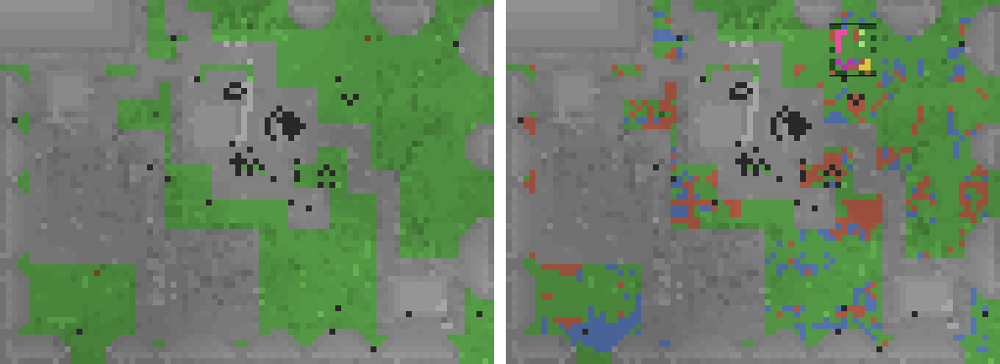

# townterrace-01: the groundskeeper's terrace stage and the town park (2026-11-03)

Owner 11-03 (ledger `townterrace-1103`): "yes, do it, add it to the grounds keeper". Clear the trees inside the town wall, grade the
town into terraces at the building floors, and add a seeded park/garden. Builds on groundskeeper-01 (`groundskeeper-2026-11-02.md`).

Branch `townterrace-on-c2a0de4f` (4 commits) on the showcase release line `showcase-yard2-on-e54d1cce` c2a0de4f (= the
groundskeeper release 62e2aff0 + copperrun-01 + stockyard-01/yardsite-01). Tier 2 (`protected.py`: not protected).
Rollback: `TERRACE=off` (the stage reads as nothing to do; the ring order goes on), or the base sha. A code rollback is clean: a
stage record's `stage` number stays groundskeeper-01's (`legacyStage`: the terrace 0, roads 1 ...), today's order is read from
`stageId` (`recStageK`).

## What it does

A new land-plan stage `terrace` right after stage 0 (town -> **terrace** -> roads -> rims), inside the wall only (the wall
record's ring, else tidy-01's 32 square). Code: `bots/src/terrace.mjs` (pure), `bots/src/park.mjs` (pure), `bots/src/tidy.mjs`
(`siteStage` dispatch, `stageCarry`, `legacyStage`), `bots/src/landplan.mjs` (the stage, `recStageK`, `parkZones`),
`bots/src/buildrun.mjs` (`useFor`, `openRole`, crop families), `bots/src/skills.mjs` (`buildTidy`, `terraceGuardNow`).

- **Trees.** Every trunk standing on soil inside is felled whole (its 26-connected logs, bottom up), one sapling planted first in
  the land plan's tree-farm zone (the road-tree rule; `buildrun.mjs` B4). A tree with no replant cell, a tree in a refusal, a park
  tree, a tree taller than a ground stand reaches (top log > 6 above its soil) stays standing and is named.
- **Terraces.** Levels are the build floors (houses, workshop, storehouse, the ziggurat's base, the tree farm, the wall's gates, the
  well's surround), plus steps of 3 through the ground's range. Each open column's 5x5 median snaps to the nearest level; small
  patches (< 12) join a neighbour. The finished ground is solved 1-Lipschitz (Dial majorant/minorant between the targets), clamped
  by every untouched neighbour to within max(1, today's step). Ramps appear where terraces meet. A column whose earthwork is
  refused (cut/fill > 4, a blocked cell, a record cell, water beside it, no feasible height) keeps its height and the solve is
  repeated round it. **Never worse:** a column the grading would leave stuck-prone keeps itself and its neighbours (up to 4
  rounds), and a blend is taken only if walkable-and-back does not fall and stuck-prone does not rise.
- **Cut and fill.** Buried fill cells are `core` (cobblestone first: the resource-model sink). The top is `earth` (dirt first, so
  grass returns). The ramp blend (5 tried) is the most balanced cut vs fill. Volumes are on the record (`terrace.cut/fill/seal/net`).
- **Caves.** A cut whose floor is air (a pocket under the cut level, <= 3 deep) fills it from the first solid below (`core` cells
  whose `opener` is the cut that exposes them, placed only after it). A deeper pocket, a wet one, or one beside a refused column
  keeps the column uncut.
- **The park.** Seeded per town (the land plan's seed: pool + home). A 7-11 box, else 5x5, on graded open ground, never within 1 of
  a road or path. Layout:
  - a 1-wide cross path, left open;
  - four quadrants in a seeded order, one element each: flowers (rotated kinds), tall flowers, azalea, one sapling with 6 air
    above, a 3x3 bamboo grove, crop plots (a hoe tills its own grass, then wheat, carrots, potatoes, beetroot, pumpkin or melon);
  - a bone-meal meadow on natural grass;
  - sugar cane on soil beside water;
  - leaf hedges on the box's edge only, with an entrance on every side and at the cross path's ends, never beside a road or path.

  Only what the town's stock and the keeper's bag hold is planned. The visit passes an element it cannot work now (`terraceSkip`),
  so a missing element never blocks the stage; a `park_skip` row names it. The park is published once on the land record (a
  reservation every later siting keeps off). Lily pads are always skipped: placing on water needs a use-item action the visit does
  not have. No palette names sweet berries, cactus or vines.
- **Never touched:**
  - wells;
  - the farm (no column within 4 of farmland);
  - protected zones;
  - expedition markers;
  - the plan's cells, boxes and plots;
  - every project's blocks and reservation;
  - the copper hall's pad;
  - road corridors (the land plan's and the paths').

  All of these are re-read at **work time** (`terraceGuardNow`, farmland included). A cell refused since siting is waived, and a
  replant cell refused since siting is published `skipped`; its tree stays standing.
- **The tripwire.** Tool uses log `op=place kind=use` on record cells. Spent bone meal is tallied, so G8 balances. Every cut, log and
  leaf is on the record's `cut`/`clear` lists. The next stage's generation carries the stage before's cells as `PREV` cells
  (`stageCarry`: no segment names them, the visit never works them). Without that, a placement read after the head moved on would
  be H1 off_record, because shopread judges placements against the HEAD record.

## Offline proof (region copies; read-only)

Fleet towns: the 16 copies of 11-02 ~18:48Z (`~/gk-1102` on the worlds host). Showcase: region + pool copied 11-03 ~00:50Z.
`node bots/scripts/terrace-offline.mjs <dump> <pool> [--all-items]`: the bots' own land plan, stage 0 (tidy-01), then the terrace
stage on the ground stage 0 leaves.

Definitions:
- **Walk** = ground columns inside the wall that a walker from the plaza's edge reaches AND can walk back from (up 1, down 3,
  two cells of head room).
- **Stuck-prone** = reached but no walk back.
- **Prot** = the record's cells, cuts, clears and replants in any protected class, checked independently against the raw
  sources: zones, well caps and plinth, farmland + 4, plan cells and plots, other records' cells and reservations, hall pad,
  markers, road corridors.
- **Worse steps** = worked columns stepping more than 1 to a neighbour where today's step was smaller.

Denominator: every town's inside (W = a wall record, else the 65x65 square).

| town | | walk raw -> stage 0 -> terrace (of cols) | stuck-prone raw -> s0 -> terrace | rough pairs s0 -> t | cut | fill | seal | trees felled (logs) / replants | worse steps | prot | park, real stock | park, all items (cells) |
|---|---|---|---|---|---|---|---|---|---|---|---|---|
| showcase | W | 3481 -> 3498 -> 3604 / 4573 | 162 -> 149 -> 110 | 1979 -> 1596 | 300 | 368 | 218 | 2 (12) / 2 | 0 | 0 | 4 (meadow only) | 30 |
| board-a | - | 934 -> 951 -> 1829 / 4155 | 886 -> 1036 -> 588 | 3676 -> 3179 | 371 | 425 | 461 | 4 (11) / 4 | 0 | 0 | 0 | 11 |
| board-b | W | 2030 -> 2045 -> 2571 / 4242 | 871 -> 871 -> 443 | 3725 -> 3482 | 103 | 248 | 116 | 2 (10) / 2 | 0 | 0 | 0 | 9 |
| board-c | - | 571 -> 620 -> 1240 / 4144 | 510 -> 487 -> 302 | 3908 -> 3476 | 173 | 601 | 186 | 0 | 0 | 0 | 0 | 4 |
| board-d | - | 1001 -> 1003 -> 1077 / 4169 | 177 -> 177 -> 143 | 3822 -> 3558 | 144 | 321 | 150 | 2 (8) / 2 | 0 | 0 | 0 | 6 |
| hive-a | - | 899 -> 918 -> 1030 / 4168 | 150 -> 145 -> 133 | 3840 -> 3705 | 53 | 134 | 76 | 0 | 0 | 0 | 0 | 5 |
| hive-b | W | 1286 -> 1316 -> 1316 / 3556 | 277 -> 285 -> 285 | unchanged | 0 | 0 | 0 | 0 | 0 | 0 | - | 8 |
| hive-c | - | 259 -> 337 -> 337 / 4196 | 760 -> 792 -> 792 | unchanged | 0 | 0 | 0 | 4 (10) / 4 | 0 | 0 | 0 | 8 |
| hive-d | - | 1254 -> 1323 -> 1848 / 4145 | 763 -> 771 -> 752 | 3354 -> 2892 | 344 | 395 | 225 | 0 | 0 | 0 | 0 | 21 |
| isolated-a | - | 507 -> 791 -> 818 / 4185 | 373 -> 188 -> 172 | 4228 -> 4014 | 97 | 208 | 123 | 0 | 0 | 0 | 0 | 9 |
| isolated-b | - | 338 -> 339 -> 339 / 4170 | 423 -> 426 -> 426 | unchanged | 0 | 0 | 0 | 4 (13) / 4 | 0 | 0 | - | - (no site) |
| isolated-c | W | 540 -> 540 -> 729 / 3152 | 261 -> 261 -> 191 | 2906 -> 2447 | 171 | 537 | 184 | 1 (4) / 1 | 0 | 0 | 0 | 27 |
| isolated-d | - | 1014 -> 1030 -> 1185 / 4180 | 328 -> 332 -> 250 | 3827 -> 3577 | 89 | 274 | 90 | 1 (4) / 1 | 0 | 0 | 0 | 25 |
| placebo-a | - | 2130 -> 2112 -> 3199 / 4199 | 485 -> 540 -> 180 | 3032 -> 2345 | 659 | 674 | 602 | 1 (4) / 1 | 0 | 0 | 0 | 11 |
| placebo-b | W | 958 -> 993 -> 1609 / 3969 | 998 -> 1010 -> 964 | 3294 -> 3013 | 114 | 253 | 118 | 3 (4) / 3 | 0 | 0 | 0 | 8 |
| placebo-c | W | 232 -> 247 -> 247 / 3299 | 779 -> 807 -> 807 | unchanged | 0 | 0 | 0 | 4 (13) / 4 | 0 | 0 | - | - (no site) |
| placebo-d | - | 2757 -> 2879 -> 3187 / 4185 | 662 -> 598 -> 348 | 3260 -> 2728 | 249 | 560 | 446 | 2 (7) / 2 | 0 | 0 | 0 | 38 |

**Totals, 17 towns:**
- **Walk-and-back:** 20,191 (raw) -> 20,942 (after stage 0) -> 26,165 columns. In the 13 towns graded it rises in every one; in 4 towns (hive-b, hive-c,
  isolated-b, placebo-c) every blend made the walk worse, so they keep their ground and only fell trees.
- **Stuck-prone:** 8,865 (raw) -> 8,875 (after stage 0) -> 6,886.
- **Earthwork:** cut 2,867, fill 4,998, seal 2,995. Fill + seal exceed the cut by 5,126 blocks: the town's surplus cobble, the
  resource-model sink.
- **Trees:** 30 felled with 30 replants.
- **Protected-class touches: 0 in every town**, with both the real stock and all items; worse steps 0.
- **Positive controls:** the same checker finds 1 per planted off-list cut, off-record place and early felling (below). The
  stage-0 cuts and fills the same records carry are checked under the same rule.

**The park with the real stock is close to empty.** The showcase's chest index holds only bone meal (9) among the park's items, and
the fleet towns' indexes none: no flowers, saplings, seeds, bamboo or leaves in any town chest. So the showcase park is a 4-cell
bone-meal meadow and a box until the keeper's own bag brings items (its bag counts at siting). With every element in stock, the
showcase park is 30 cells: 5 flowers, 3 tall flowers, 3 crop plots, 2 meadow, 17 hedge (14 after the cut filter); the tree is
skipped for want of 6 air above. See **Not done**.

Planning time: 4-16 s a town offline on the worlds host under load 9-11. On a bot it yields between solves (each 0.3-0.9 s).

Picture (`townterrace-2026-11-03/showcase-terrace.png`, north up, 6 px a column): left is the showcase as copied, right is after
stage 0 + the terrace stage with all items.

Key:
- grey: every refusal (builds, reservations, paths, wall, plan);
- green: ground shaded by height;
- red: cut;
- blue: filled;
- brown dots, left: trees felled;
- the black box: the park (pink and yellow its flowers and crops, dark green its hedge).

## The tripwire (main's shopread.py, tidyread-01's rule)

`townterrace-2026-11-03/tripreplay.py.txt` turns the showcase terrace record into the rows a keeper would log: every replant, cut,
log, leaves clear, fill, seal and park placement (`kind=use` for the hoe and the bone meal), plus a foreign dig. It runs them
through main's `judge` with the showcase's protected zones.

**Result: 984 rows (616 placements, 364 clears), every H item 0:** off_record, clear_outside, zone, lease_overlap,
felled_unplanted, bag_loss, oracle_missing, zone_unknown and g5_unjudged.

Positive controls, each of which reads 1:
- an off-list cut: H2;
- an off-record place: H1;
- a felling before its sapling: H5.

**For the showcase owner: the tripwire's place rule reads only the HEAD record.** A tidy stage's placements read after the next
stage is sited would be H1 off_record. This branch carries the stage before's cells into the next generation (`stageCarry`), so
these rows stay on the record. groundskeeper-01's release (62e2aff0 / c2a0de4f) has no such carry: a stage-0 fill placed and then
read after the roads stage is sited is off_record on that release.

## Reviews

Codex (`codex exec`, read-only) and a Claude reviewer (tripwire-adjacent), blockers only:

| round | blockers found | fixed in |
|---|---|---|
| r1 | Claude: a park cell sat on a cut column's lowest cut, so the stage never completed. Codex: the skip rule read the raw bag, not `effects.has` (a reserved item meant `no_material`); replants were not re-guarded at work time; a tree could be felled with no replant cell; the work-time guard lacked the farmland buffer. | r2 |
| r2 | Both: `stageCarry` could carry a stage-0 fill onto a terrace cut, so the stage never completed. Codex: PREV cells in the completion's unread check. Claude: the visit-only replant filter broke G5. | r3 |
| r3 | Codex: a failed skip publish let the visit go on. Claude: a kept tree in fill cells would be felled by the foreign pass. | r4 |
| r4 | none (both) | |

Notes not acted on:
- a fill cell above a kept trunk's top log is still laid;
- a kept tree's listed leaves are still cut;
- records grow with PREV cells (at most 8,000).

## Tests

- `bots/test/terrace.test.mjs`: 36 tests. They cover the levels, floors, the 1-Lipschitz grading against a plateau, refusals,
  cave seals, the farm guard, trees and replant pairing, the walk guard, park determinism and skips, the hedge rule, the skip rule,
  the bill, and a real `runVisit` of a park on buildfake (tilled, planted, greened, a missing element passed). They also cover
  `stageCarry`, `legacyStage` and `recStageK`, and the wiring.
- 9 mutants, each anchor asserted present and unique, all killed: the floor seal, the free-column refusal, the anchors' bound,
  the hedge's road rule, the seal's opener rule, `useFor`, the foreign pass on a tool's cell, the bone meal tally, and the crop
  family. A composed control shows the skip rule's absence stops the visit `no_material`.
- `groundskeeper.test.mjs` follows the new order: 33 passed.
- eslint over `src/*.mjs` is clean.
- Full suite on the worlds host: see the commit that records it.

## What the showcase 2-h read should check

1. **Rows:**
   - `_build project=tidy op=sited seg=stage1` (the terrace);
   - `land_plan op=park_planned` (once);
   - `_build op=park_skip` (what was passed and why);
   - `replant_skipped why=guarded` (expected 0).
2. **Tripwire:** H1-H6 = 0 for project=tidy. Watch H1 around a stage change, and G5 g5_unjudged = 0.
3. **The world, inside the wall:** trees felled only after their saplings read planted, and 0 blocks touched in a protected class.
   For the latter, re-run `terrace-offline.mjs` on a fresh region copy and diff it against the record. Cut and fill progress
   should follow the record's `terrace.cut/fill/seal`.
4. **The goals, as denominators against the 2 h before:**
   - walk failures (`walk_failed`, `no_reach` on in-town legs);
   - `stuck_on_cell` / stuck alarms;
   - in-town `town_deposit` / `withdraw` failure shares.
5. **No visit stuck on the terrace:**
   - `_build_visit` stops `no_material` / `no_tool` should be 0 for project=tidy;
   - `deferred why=attempts_spent` named;
   - the stage completes (`structure_complete project=tidy`), then the roads stage is sited.

## Not done

- **Materials for the park.** No town holds flowers, saplings, seeds, bamboo or leaves in its chests (chest index read above), so
  the park plants only what the keeper's own bag carries at siting. The ~4,000 bamboo the owner mentions are in bot bags, not in
  chests. A park gather (like copperrun-01's bill-driven copper gather) or a deposit rule for park items would fill it.
- **Lily pads:** skipped. Placing on water is a use-item action with its own protocol, which the visit does not have.
- **Hedges** need leaf blocks, which only shears give. No town holds any, so the hedge is skipped wherever leaves are absent.
- **Paper / mineflayer proof** of the hoe and bone-meal uses: they ride paths-01's shovel actuator (`block_place` on the top
  face), proven on buildfake only, never on a live server.
- **Not activated anywhere.** No showcase release, no fleet canary, no change to the tripwire.
